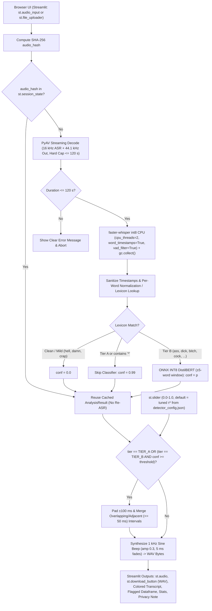

# Automated Speech Censor — Implementation Plan (Revised)

**Course:** AIC354 Machine Learning Fundamentals (COMSATS Lahore, Fall 2026)  
**Deadline:** Sunday, 29 Nov 2026 at 23:59 (5%/day late penalty; 0 after 3 days)  
**Target Spec:** [Voice Profanity Beeper Requirements Specification.md](file:///d:/A/Comsats/5th%20Sem/ML/ASS/ASS%204/Voice%20Profanity%20Beeper%20Requirements%20Specification.md)  
**Reference Repo Checked:** `haqnawaz99/ml-teaching-notebooks` (uses Streamlit Community Cloud, `@st.cache_resource`, `joblib` `.pkl` artifacts, `DummyClassifier` majority baseline, and Variation 1 unweighted vs. Variation 2 `class_weight='balanced'` comparison)

---

## A. Source, Platform & Environment Availability (Verified 22 Nov 2026)

| Source / Platform | Status | Note |
| --- | --- | --- |
| **Streamlit Community Cloud** (`share.streamlit.io`) | ✅ Selected ($0, no card, HTTPS) | **1 free private GitHub repo slot**; container limits **690 MB – 2.7 GB RAM** (OOMs often trigger near ~1 GB), up to **2 vCPU**, 12-hour inactivity sleep. **Must toggle App Settings → Sharing → Public** after deploy so the `*.streamlit.app` URL works without login while the GitHub repo stays private. |
| **Hugging Face Spaces** (`cpu-basic` / ZeroGPU) | ❌ Dropped | New free accounts hit `HTTP 402` on `cpu-basic` and require >30-day account age for ZeroGPU. |
| **Private Hugging Face Hub Model Repo** | ✅ Free | Stores trained weights (`distilbert_int8.onnx`, tokenizer files, `detector_config.json`, `tfidf_vectorizer.pkl`, `best_model.pkl`, `best_classical_pipeline.pkl`) outside GitHub; fetched once at startup via `hf_hub_download(..., token=st.secrets["HF_TOKEN"])`. |
| Jigsaw Toxic Comment (Kaggle competition) | ✅ Live (HTTP 200) | Click **Join / Accept Rules** once on [Kaggle](https://www.kaggle.com/c/jigsaw-toxic-comment-classification-challenge) to attach as notebook input (`train.csv`: 159,571 rows, `obscene=1`: 8,449 / ~5.29%; scored `test_labels != -1`: 63,978 rows). |
| HF mirror `thesofakillers/jigsaw-toxic-comment-classification-challenge` | ✅ Ungated (`cc-by-sa-3.0`) | Fallback if Kaggle competition attachment fails. |
| `unitary/toxic-bert` (HF) | ✅ Live (`apache-2.0`) | Pre-trained **in-domain** model (already fine-tuned by Unitary on Jigsaw 2018 `train.csv`, NOT zero-shot). |
| `cardiffnlp/twitter-roberta-base-offensive` (HF) | ✅ Live | True **cross-domain zero-shot** transfer baseline (trained on TweetEval/OLID; `offensive` label is broader than Jigsaw `obscene`). |
| `distilbert/distilbert-base-uncased` (HF) | ✅ Live (`apache-2.0`) | Base model to fine-tune in NB02, then export & quantize to **ONNX INT8** (~65 MB) for zero-PyTorch deployment. |
| `Systran/faster-whisper-{tiny,base,small}.en` (HF) | ✅ Live (`mit`) | CTranslate2 ASR weights with word timestamps (`int8`, CPU). |
| `openslr/librispeech_asr` (`test-clean`, HF) | ✅ Live (`cc-by-4.0`) | Stream 200 utterances for NB03 WER/RTF/RAM eval. **Windows fix:** pass `Audio(decode=False)` and decode FLAC bytes via `soundfile`/PyAV to avoid `datasets >= 4.0` `torchcodec` FFmpeg DLL crashes. |
| LDNOOBW English bad-word list (GitHub raw) | ✅ Live (`CC-BY-4.0`, 404 lines) | Base English list; cleaned by `scripts/build_lexicon.py` (drop multi-word phrases/noisy anatomy terms, add common spoken inflections, exclude mild intensifiers `hell`/`damn`/`crap`). |
| Runtime dependencies (`requirements.txt`, Streamlit Cloud) | ✅ Lightweight (NO `torch`) | `streamlit>=1.50` (`st.audio_input(sample_rate=...)` requires ≥1.50; latest 1.67), `faster-whisper>=1.2.1`, `onnxruntime`, `tokenizers`, `huggingface_hub`, `soundfile`, `numpy`, `pandas`, `scikit-learn`, `joblib`. **Zero `torch` in deployment** to avoid build timeouts and OOM kills. |
| Dev/eval dependencies (`requirements-dev.txt`) | ✅ Local + Kaggle | `edge-tts>=7.3.1` (fixes Microsoft 403 token changes), `jiwer>=4.0.0`, `datasets`, `pytest`. |
| Local machine | ✅ Ready for dev | Python 3.13.0 installed globally, pip 24.2; **use Python 3.12 for the local `.venv`** and **set Python 3.12 in Streamlit Cloud → Advanced settings at deploy time** (`runtime.txt` is ignored by Streamlit Cloud) for runtime parity; no NVIDIA GPU (training on Kaggle); no system `ffmpeg` on PATH (PyAV bundled with `faster-whisper` decodes audio; `soundfile` handles WAV/FLAC); install `cloudflared` binary for NFR-4 HTTPS fallback tunnel. |

---

## B. Things You Must Do (Checklist)

1. **Kaggle setup:**
   - Join <https://www.kaggle.com/c/jigsaw-toxic-comment-classification-challenge> and accept the competition rules.
   - Use **CPU** for NB01 and **GPU T4 x2** (with `CUDA_VISIBLE_DEVICES=0` for clean single-T4 `fp16` training, avoiding deprecated `DataParallel` quirks) + **Internet = ON** for NB02.
2. **Hugging Face Hub setup (Private Model Repo):**
   - Create a **private model repo** `<HF_USER>/asc-models` on Hugging Face.
   - Create a **Write** token (add to Kaggle Secrets as `HF_TOKEN` and local `hf auth login`) and a **Read** token (for Streamlit Cloud Secrets `HF_TOKEN`).
3. **Private GitHub Repo + Streamlit Community Cloud setup:**
   - Create a **private GitHub repo** for this project and push `app.py`, `requirements.txt`, `censor/`, and `lexicon/`.
   - On <https://share.streamlit.io>, deploy `app.py` from that private repo (uses your 1 free private-repo slot).
   - Add `HF_TOKEN = "<your_read_token>"` and `HF_REPO_ID = "<HF_USER>/asc-models"` in **App Settings → Secrets**.
   - **Immediately open App Settings → Sharing → set app visibility to Public** so anyone (instructor, mobile phone) can open the `*.streamlit.app` URL without logging in while your GitHub source code stays private.
4. **Local environment & NFR-4 fallback:**
   - Approve creating `.venv` locally (`requirements.txt` + `requirements-dev.txt`) and having `cloudflared` ready (`cloudflared tunnel --url http://localhost:8501` gives an automatic `https://*.trycloudflare.com` URL required for browser mic access).
5. **Real-world evaluation recordings (20–30 clips):**
   - Record 20–30 short English clips (5–20 s each, you + friends): a mix of clips with Tier A profanity, Tier B profane uses (`ass`, `dick`, `bitch`, `cock`), tricky clean clips (`"class"`, `"Dick"` as a name, benign `"ass"`/`"bitch"`/`"cock"` contexts), and mild-word clean clips (`"hell"`, `"damn"`, `"what the hell"` — expected uncensored).
   - Label ground truth in `data/e2e_real/labels.csv` with columns `file,profane_words`.
6. **Final checks & Google Classroom submission:**
   - Put the live `https://<app>.streamlit.app` URL at the **very top** of the main Jupyter notebook.
   - Package for Classroom: notebooks + app code, zipped Jigsaw CSVs (or Drive attachment if over upload cap), classical `tfidf_vectorizer.pkl` + `best_model.pkl`, and quantized `distilbert_int8.onnx` (~65 MB).
   - Build slides (matching `ppt_Semester Project.pptx`) + **Course Feedback** (TODO items left for you). *(Task 1 requires no Classroom upload.)*

---

## C. System Architecture, Data Flow & API Contract



### Key Architectural Decisions
- **One-time startup loading (NFR-6):** `@st.cache_resource` loads Whisper (`faster-whisper`), the ONNX INT8 DistilBERT session (`onnxruntime.InferenceSession` + `tokenizers.Tokenizer`) or `joblib` TF-IDF fallback, and `detector_config.json` (which sets `detector.threshold = τ*`) once per container boot from the private HF Hub repo (`st.secrets["HF_TOKEN"]`).
- **Zero-PyTorch cloud footprint:** Exporting DistilBERT to **INT8 ONNX** (~65 MB disk, ~250–350 MB RAM, 1.5×–3× faster on CPU) removes `torch` entirely from Streamlit Cloud's `requirements.txt`, preventing both build timeouts and container OOM kills.
- **Two-tier lexicon + context classifier (updated policy):**
  - **Excluded mild words:** `hell`, `damn`, `crap`, `heck` (and phrases like `"what the hell"`) are **not** in the lexicon and stay uncensored, aligning the product policy cleanly with Jigsaw `obscene`.
  - **Tier A (unambiguous profanity + `*`-masked ASR tokens):** e.g., `fuck`/`fucking`/`fucked`/`fucker`, `shit`/`shitty`/`bullshit`, `motherfucker`, `cunt`, etc., plus any Whisper token containing `*`. **Skips the context classifier** (`conf = 0.99` for display only) to save CPU latency and RAM. **Always beeped regardless of slider** (the sensitivity slider cannot un-beep unambiguous profanity).
  - **Tier B (ambiguous profanity — still censored in profane use):** `ass`, `dick`, `bitch`, `cock`, `pussy`, `prick`, `bastard`, `whore`, `slut`, `balls`, etc. Disambiguated by the context classifier over a `±5`-word window (`conf = p`) so harmless uses (`"Dick"`, `"class"`, benign contexts) stay clean at the default tuned threshold `τ*` while profane uses are beeped.
  - **Beep decision rule (fixes slider=0 bug):** `beeped = (tier == "TIER_A") or (tier == "TIER_B" and conf >= threshold)`. `CLEAN` words are never beeped even when the slider is set to `0.0`.
  - **Tuned default threshold (`τ*`):** NB02 picks `τ*` maximizing F2 on the 10% validation split (DistilBERT); NB01 picks `τ*` for the classical fallback from out-of-fold 10-fold CV probabilities. `τ*` is saved to `detector_config.json` (`{"model": ..., "threshold": τ*, "metric": "F2"}`) and pushed to the HF repo with the weights; the app loads it in `@st.cache_resource` and uses it as the slider default (falling back to `0.5` only if `detector_config.json` is missing). Test-set metrics are reported at both `0.5` and `τ*`.
- **Audio & timestamp safety:**
  - **Upload formats (FR-2):** `st.file_uploader` accepts `type=["wav", "mp3", "m4a", "aac", "mp4", "webm", "ogg"]` (including `mp4`/`m4a` produced by iOS Safari).
  - **Streaming 120 s length guard:** Checks container metadata when present *and* halts PyAV packet decoding immediately if decoded samples exceed 120 s (handles browser recordings with missing duration headers without RAM spikes).
  - **Timestamp sanitization:** Clamps every `word.start`/`word.end` to `[0.0, duration_s]`; enforces a minimum 50 ms span if Whisper emits `end <= start`; strips leading spaces and handles hyphen/apostrophe splits.
  - **Interval merging before beeping:** Pads each flagged word by `±100 ms`, clamps to `[0, duration_s]`, and **merges overlapping/adjacent intervals (gap `≤ 50 ms` after `±100 ms` padding)** before synthesizing a single continuous 1 kHz sine beep (amp 0.3, 5 ms fade-out/fade-in) per merged span—eliminating mid-beep clicks on consecutive swear words.
- **Instant slider re-thresholding (FR-9) & strict privacy (FR-11 / NFR-8):**
  - `st.audio_input(sample_rate=44100)` and `st.file_uploader` yield in-memory bytes. PyAV decodes directly from `io.BytesIO` so temp files are avoided altogether; a `finally:` cleanup block is retained for any fallback temp path (FR-11).
  - `AnalysisResult` is cached in `st.session_state` keyed by `audio_hash` (SHA-256). Moving `st.slider` reruns only `render_censored_audio(...)` (~20 ms) without re-decoding or re-transcribing; uploading/recording new audio replaces the previous session entry.
  - Colored transcript uses Streamlit's native `:red-background[word (0.99)]` markdown syntax (zero raw-HTML XSS risk).

### Frontend ↔ Backend API Contract (Spec §10)

```python
@dataclass
class WordEvent:
    word: str          # Original ASR token (stripped)
    norm: str          # Lowercased alphanumeric normalized token
    start: float       # Sanitized start time (seconds, clamped)
    end: float         # Sanitized end time (seconds, end > start)
    tier: str          # "CLEAN" | "TIER_A" | "TIER_B"
    conf: float        # 0.0 (CLEAN), 0.99 (TIER_A, display only), or classifier p in [0, 1] (TIER_B)
    window: str        # ±5-word context snippet (for debugging/UI)

@dataclass
class AnalysisResult:
    audio_hash: str
    sample_rate: int   # Output PCM sample rate (e.g., 44100 or 16000)
    audio_pcm: np.ndarray  # float32 mono waveform in [-1, 1]
    duration_s: float
    asr_time_s: float
    clf_time_s: float
    words: list[WordEvent]
```

- Detector object exposes `detector.threshold: float` (loaded from `detector_config.json`, fallback `0.5`).
- `censor.pipeline.analyze_audio(audio_bytes: bytes, filename: str, asr_model, detector, lexicon) -> AnalysisResult`  
  Raises `AudioTooLongError` (>120 s) or `AudioDecodeError` (corrupt/unsupported format).
- `censor.pipeline.render_censored_audio(analysis: AnalysisResult, threshold: float) -> tuple[bytes, list[dict]]`  
  Caller passes the slider value (defaulting to `detector.threshold`). Uses `beeped = (w.tier == "TIER_A") or (w.tier == "TIER_B" and w.conf >= threshold)`. Returns `(wav_bytes, flagged_rows)` where each row has `{"word", "start", "end", "tier", "conf", "beeped"}`.
- `st.session_state` keys: `"last_audio_hash"`, `"analysis"` (`AnalysisResult`), `"threshold"` (`float`, initialised from `detector.threshold` loaded via `detector_config.json`).

---

## D. ML Experiments & Evaluation Plan (Rubric Items 3–4)

- **Target label:** Jigsaw Toxic Comment `obscene` column (8,449 positive / 159,571 rows = **5.29% positive**; 94.71% negative).
- **Metrics:** Report **Accuracy** (required by rubric/instructor), **Precision**, **Recall**, **F1**, and **F2-score** (weights Recall 2× Precision), explicitly stating **Recall is prioritised over Precision** (missed profanity is worse than a false beep) and highlighting **"The Accuracy Trap"** via `DummyClassifier(strategy='most_frequent')` (mirroring Dr. Adeel's `English_Emotion_Analysis_BinaryClass.ipynb`). **Name the best model explicitly** and justify selecting by **F2** (recall-prioritised) rather than the reference notebook's minority-class F1, while also reporting F1.
- **Domain-shift & casing caveats (to report):** Text classifiers are trained on full written Wikipedia talk comments and applied at inference time to `±5`-word ASR transcript windows; additionally, uncased DistilBERT cannot use Whisper capitalisation cues (e.g. `"Dick"` as a proper name). Report both as known limitations.

| Notebook | Compute | Dataset & Protocol | Models / Setup | Outputs & Artifacts |
| --- | --- | --- | --- | --- |
| `01_classical_tfidf_10fold.ipynb` | Kaggle CPU | Full `train.csv` (159,571 rows); `Pipeline(TfidfVectorizer, clf)` inside `StratifiedKFold(10, shuffle=True, random_state=42)` via `cross_validate` + refit on full train and score on official labelled test set (`test_labels != -1`, 63,978 rows) | **Baselines:** `DummyClassifier(strategy='most_frequent')` + **Lexicon-only** (report Tier A only *and* Tier A+B). **Variation 1 (no class weights)** vs. **Variation 2 (`class_weight='balanced'`)**: Variation 2 applies to LR, calibrated LinearSVC and RF only (`ComplementNB` has no `class_weight` and appears in Variation 1 only, matching the reference notebook): `LogisticRegression(max_iter=1000)`, `LinearSVC` (wrapped in `CalibratedClassifierCV(method='sigmoid', cv=3)` for `[0,1]` probabilities), `RandomForestClassifier(n_estimators=100, max_depth=30, min_samples_leaf=5, n_jobs=-1)` with TF-IDF `max_features=5000, min_df=5`; plus `ComplementNB` (others use word 1–2 grams, `max_features=50000, min_df=3, sublinear_tf=True`). | 10-fold CV + test comparison table (Acc, P, R, F1, F2); Variation 1 vs. 2 before/after chart; confusion matrices; Step 9 unseen-text inference cell; `tfidf_vectorizer.pkl` + `best_model.pkl` (mirroring reference Step 9) and `best_classical_pipeline.pkl` (used by app fallback) + `detector_config.json` with classical `τ*` (from out-of-fold 10-fold CV probabilities) saved via `joblib` and pushed to private HF Hub repo. |
| `02_transformers.ipynb` | Kaggle GPU (single T4 via `CUDA_VISIBLE_DEVICES=0`, avoids `DataParallel` bugs) | Official labelled test set (`test_labels != -1`, 63,978 rows) for evaluation; `train.csv` 90/10 stratified val split (`seed=42`) for fine-tuning & validation F2 threshold tuning (fixed train/test protocol due to compute limits) | **Pre-trained in-domain (no fine-tuning):** `unitary/toxic-bert` (`obscene` sigmoid ≥ 0.5; explicitly note trained on Jigsaw 2018 `train.csv`, not zero-shot). **Cross-domain zero-shot transfer:** `cardiffnlp/twitter-roberta-base-offensive` (`offensive` softmax ≥ 0.5; document OLID label shift). **Fine-tuned:** `distilbert/distilbert-base-uncased` (`max_len=128`, `batch_size=32`, `lr=2e-5`, 2 epochs, `fp16`). **ONNX INT8 export** + parity check on test set + 15-sentence Tier B sanity probe (`ass`/`dick`/`bitch`/`cock` profane vs. benign). | Transformer comparison table (Acc, P, R, F1, F2); FP32 vs. ONNX INT8 parity table; validation-F2 `τ*` → `detector_config.json`; test metrics reported at both `0.5` and `τ*`; `distilbert_int8.onnx` (~65 MB) + `tokenizer.json` + `detector_config.json` pushed to private HF Hub repo `<HF_USER>/asc-models`. |
| `03_asr_eval.ipynb` | Kaggle CPU or Local CPU (using `Audio(decode=False)` + `soundfile`/PyAV) | 200 utterances streamed from `openslr/librispeech_asr` (`test-clean`) + profanity-word recall on TTS subset | `Systran/faster-whisper-tiny.en`, `base.en`, `small.en` (`int8`, CPU, `cpu_threads=2`) | WER (`jiwer`), RTF, **peak RAM (MB)**, and profanity-word recall table justifying the ASR model size that fits Streamlit Cloud RAM & NFR-2 (<30 s/min). |
| `04_e2e_eval.ipynb` | Local CPU | ~120 TTS clips via `edge-tts>=7.3.1` (`Communicate(..., boundary="WordBoundary")`, sequential `concurrency=1`, `0.4 s` delay, skip-if-exists checkpointing; multiple voices, profane + Tier B tricky-clean + mild-clean) + 20–30 real clips (`data/e2e_real/`) | Full end-to-end audio pipeline (same `censor/` code as deployed app) | Word-level beep P/R/F1/F2 (time-overlap match), **Tier B recall reported separately**, beep boundary timing error (ms, TTS only), RTF, synthetic-vs-real gap & failure-case taxonomy. |

- **Deployment model choice:** Deploy **ONNX INT8 DistilBERT** (`onnxruntime` + `tokenizers`, ~65 MB, zero `torch`) if its recall-weighted F2 beats classical ML and combined RAM (`faster-whisper` + ONNX session) passes the Streamlit Cloud smoke test; otherwise seamlessly switch `detector.py` to the `joblib` TF-IDF + calibrated Logistic Regression pipeline (<20 MB RAM).
- **TTS fallback:** If `edge-tts` is rate-limited or blocked, synthesize word-by-word via Windows SAPI (`pyttsx3`) and concatenate with known gaps to retain exact word-boundary timestamps.

---

## E. Repository Structure & Deployment

```text
ASS 4/                                   # Root of private GitHub repo connected to Streamlit Cloud
├── app.py                               # Streamlit UI (deployed entry point on share.streamlit.io)
├── requirements.txt                     # Streamlit Cloud runtime deps (NO torch!)
├── requirements-dev.txt                 # Local eval/test deps (edge-tts, jiwer, datasets, pytest)
├── .streamlit/
│   └── config.toml                      # maxUploadSize, theme, headless settings
├── censor/
│   ├── __init__.py
│   ├── audio.py                         # PyAV streaming decode (<=120 s cap), resampling, WAV bytes export
│   ├── lexicon.py                       # Two-tier lexicon lookup, normalization & compound handling
│   ├── detector.py                      # Context classifier (ONNX INT8 DistilBERT / joblib TF-IDF fallback)
│   ├── beep.py                          # Interval padding, overlap merging, 1 kHz sine beep + 5 ms fades
│   └── pipeline.py                      # AnalysisResult / WordEvent contract, analyze_audio, render_censored_audio
├── lexicon/
│   └── profanity_lexicon.csv            # word,tier (TIER_A / TIER_B; mild words excluded)
├── notebooks/
│   ├── 01_classical_tfidf_10fold.ipynb  # Live Streamlit Cloud URL in very top markdown cell
│   ├── 02_transformers.ipynb
│   ├── 03_asr_eval.ipynb
│   └── 04_e2e_eval.ipynb
├── scripts/
│   ├── build_lexicon.py                 # Downloads & cleans LDNOOBW + adds curated Tier A/B inflections
│   ├── gen_tts_testset.py               # Sequential edge-tts generator with 0.4 s throttle & checkpointing
│   └── run_e2e_eval.py
├── docs/                                # Spec + revised implementation plan copies
├── data/                                # Git-ignored large audio/CSV outputs
│   ├── e2e_tts/
│   └── e2e_real/
└── tests/
    ├── test_beep.py                     # Padding, overlap merging, fades, zero-length/clamped spans
    ├── test_lexicon.py                  # Tier A/B matching, Scunthorpe ("class"), mild words clean, '*' tokens
    └── test_pipeline.py                 # End-to-end mock ASR/detector, 120 s guard, slider re-thresholding
```

- **Cloud deployment (zero cost, no card):** Push to private GitHub repo → deploy `app.py` on **Streamlit Community Cloud** (`share.streamlit.io`, 1 free private repo slot; **select Python 3.12 under Advanced settings** since `runtime.txt` is ignored) → set `HF_TOKEN` & `HF_REPO_ID` in Secrets → **set App Settings → Sharing → Public** → verify from a mobile phone / incognito browser.
- **Fallback live demo (NFR-4):** `streamlit run app.py` locally + `cloudflared tunnel --url http://localhost:8501` (gives an instant HTTPS `*.trycloudflare.com` URL so `st.audio_input` microphone permissions work on any browser if Streamlit Cloud sleeps or venue Wi-Fi struggles).

---

## F. Day-by-Day Schedule

| Day | Planned Work |
| --- | --- |
| **Sun 22 (Tonight)** | Complete Checklist items 1–4: accept Kaggle rules, create private HF Hub model repo + tokens, create private GitHub repo, approve `.venv` setup |
| **Mon 23** | **First thing:** launch NB01 & NB02 on Kaggle. While training runs: scaffold repo, run `build_lexicon.py`, build `censor/` package + unit tests (`pytest`), run local Streamlit app (`streamlit run app.py`) with lexicon-only detector |
| **Tue 24** | Finish NB02 ONNX INT8 export & push to private HF Hub; deploy Streamlit Cloud v1 (**set Sharing → Public**) and **run RAM/latency smoke test** (`base.en` vs. `tiny.en` + ONNX INT8); run NB03 (ASR WER/RTF/RAM) and lock Whisper size; generate ~120-clip TTS test set |
| **Wed 25** | Finalize classifier selection in Streamlit Cloud (`distilbert_int8.onnx` or `joblib` fallback) and redeploy; test live `*.streamlit.app` URL on a mobile phone (mic + upload + slider); record 20–30 real clips + `labels.csv` |
| **Thu 26** | Run end-to-end eval (NB04) on TTS + real clips; analyze synthetic-vs-real gap and failure cases; measure Streamlit Cloud cold start & 1-min clip latency |
| **Fri 27** | Fix priority failure cases, compile final comparison tables (matching Dr. Adeel's report/notebook layout), finalize README/report, verify Classroom bundle (code + zipped dataset + `.pkl` + `.onnx` + live URL at top of main notebook) |
| **Sat 28** | You build slides (matching `ppt_Semester Project.pptx`) + Course Feedback; test `cloudflared` fallback tunnel; buffer day |
| **Sun 29** | Final dry run (warm up Streamlit Cloud 5 min ahead) and submit to Google Classroom before **23:59** |

---

## G. Cut-Line (Drop Order If Time Runs Out)

Drop in this strict order:
1. RoBERTa fine-tuning *(already excluded)*
2. `cardiffnlp/twitter-roberta-base-offensive` cross-domain transfer comparison
3. Reduce real-recording test set from 30 to the spec minimum of 20 (never below 20)
4. Compress Random Forest via `TruncatedSVD(n_components=150)` or reduce `n_estimators=50` if 10-fold CV stalls
5. Reduce NB04 TTS test set from 120 clips to 60 clips
6. If Streamlit Cloud OOMs with `base.en` + ONNX DistilBERT: drop to `tiny.en` + ONNX DistilBERT first, or `base.en` + `joblib` Logistic Regression (<20 MB RAM)

**Never cut:** NB01 full model comparison table (`DummyClassifier` + Variation 1 vs. 2), live public Streamlit Cloud URL, working mic/upload → instant slider → beeped WAV download.

---

## H. Risks & Mitigations

| Risk | Mitigation |
| --- | --- |
| **Streamlit Cloud container OOM (~1 GB practical ceiling)** | Zero `torch` in `requirements.txt`; deploy **ONNX INT8 DistilBERT** (~65 MB) via `onnxruntime` + `tokenizers`; cap `cpu_threads=2`; call `gc.collect()` after Whisper; RAM-test `base.en` vs. `tiny.en` on Day 2; keep `joblib` LR (<20 MB RAM) ready as drop-in fallback |
| **Private GitHub repo defaults Streamlit app to login-walled** | Immediately toggle **App Settings → Sharing → Public** after deploy; verify in incognito & on a separate phone |
| **Streamlit Cloud 12-hour sleep during live demo** | Open URL 5–10 min before presenting to wake container; keep local `streamlit run app.py` + `cloudflared` HTTPS tunnel ready (NFR-4) |
| **Whisper masks profanity with `*` or softens/drops it** | Any token containing `*` is auto-flagged as Tier A (`conf = 0.99`); measure actual profanity recall per model size in NB03; ASR module stays swappable |
| **Word timestamp drift, overlaps, or inverted spans (`end <= start`)** | Clamp timestamps to `[0, dur]`, enforce min 50 ms span, apply `±100 ms` pad, **merge overlapping intervals** before synthesizing continuous beep + 5 ms fades; measure boundary error in NB04 |
| **Kaggle T4 x2 `Trainer` `DataParallel` + `fp16` crash** | Pin `CUDA_VISIBLE_DEVICES=0` in NB02 (single T4 finishes 2 epochs of DistilBERT in ~15–20 min cleanly) or use `!accelerate launch` |
| **Windows `datasets >= 4.0` `torchcodec` FFmpeg DLL error in NB03** | Cast audio column with `Audio(decode=False)` and decode FLAC bytes via `soundfile`/PyAV, or run NB03 on Kaggle |
| **`edge-tts` Microsoft rate limits / 403 errors** | Pin `edge-tts>=7.3.1`, synthesize sequentially (`concurrency=1`) with `0.4 s` pause and skip-if-exists checkpointing; fallback to `pyttsx3` if needed |
| **Random Forest 10-fold CV slow on 159k sparse rows** | Cap TF-IDF (`max_features=5000, min_df=5`) and constrain trees (`max_depth=30, min_samples_leaf=5, n_jobs=-1`) |

---

## I. Revision Log (22 Nov, post-review)

- **Streamlit & Python pins (a):** Bumped `requirements.txt` minimum from `streamlit>=1.40` to `streamlit>=1.50` (`st.audio_input(sample_rate=...)` requirement); specified Python 3.12 in Streamlit Cloud Advanced settings and local `.venv` (since `runtime.txt` is ignored).
- **Tier A vs. Tier B slider policy & slider=0 fix (b, c, d):** `TIER_A` (unambiguous profanity + `*`-masked tokens) is always beeped regardless of slider; `CLEAN` words are never beeped; `st.slider` controls `TIER_B` only via `beeped = (tier == "TIER_A") or (tier == "TIER_B" and conf >= threshold)`.
- **Validation-tuned default threshold `τ*` (b, c, d, e):** NB02 (validation split) and NB01 (out-of-fold 10-fold CV) tune `τ*` maximizing F2 and export `detector_config.json`; the app defaults the slider to `τ*` (fallback `0.5` only if missing), and test-set metrics are reported at both `0.5` and `τ*`.
- **Audio, privacy & upload details (c):** Defined adjacent interval merging as gap `≤ 50 ms` after `±100 ms` padding; specified FR-2 uploader extensions including `mp4`/`m4a` for iOS Safari; noted in-memory `io.BytesIO` decoding with `finally:` cleanup retained.
- **Notebook & evaluation clarifications (e, i):** Clarified `ComplementNB` appears in Variation 1 only (no `class_weight`); added explicit best-model naming & F2-vs-F1 justification, uncased/`±5`-word domain-shift limitations, separate Tier B recall in NB04, and why both `tfidf_vectorizer.pkl` + `best_model.pkl` (reference Step 9) and `best_classical_pipeline.pkl` (app) are saved.
- **Real-clip count (f, g, h):** Kept 20–30 real recordings across checklist, schedule, and NB04; cut-line stops at the spec minimum of 20 (never 10).
